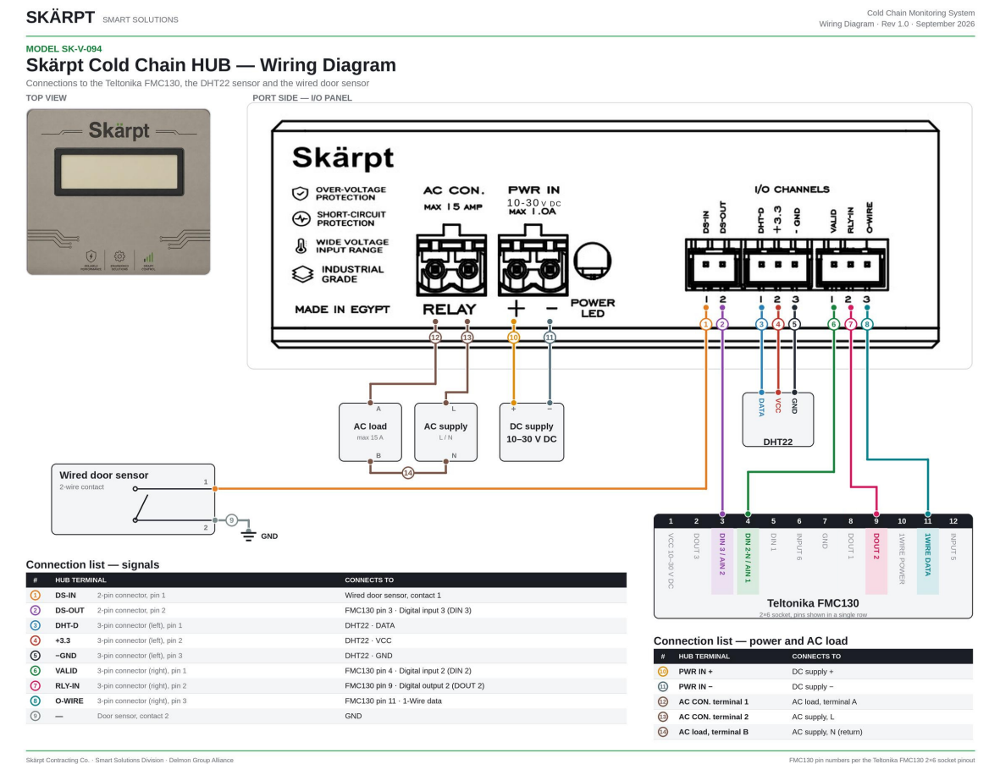

# Skärpt Cold Chain HUB (SK-V-094)

THS202-compatible 1-Wire temperature and humidity hub with Bluetooth Low Energy broadcast, for cold-storage monitoring with a Teltonika FMC130.

To an existing 1-Wire master the hub appears exactly like a THS202 sensor, so the controller needs no changes. The same readings are also advertised over Bluetooth Low Energy. The hub also monitors a door contact, sounds a local alarm when limits are exceeded, mirrors a relay command, and reports its own health on a dedicated output.

> **Documentation-only repository.** Firmware source code and firmware binaries are proprietary and are not distributed here.

## Key features

- Drop-in THS202-compatible 1-Wire slave
- Bluetooth Low Energy broadcast every 100 ms, no pairing required
- DHT22 temperature and humidity, refreshed every 2.5 s (0.1 °C / 0.1 % RH resolution)
- Local audible alarm with distinct patterns for temperature, humidity and combined conditions
- Interrupt-driven door monitoring with status output and on-screen indication
- Health validation output and dual watchdogs: a failed sensor or silent bus is flagged instead of publishing bad data

## Specifications

| | |
|---|---|
| Power supply | 10–30 V DC (max 1.0 A) |
| AC load relay | Max 15 A |
| Sensing | DHT22: −40 to +80 °C, 0–100 % RH, ±0.5 °C / ±2 % RH typical |
| Bus | Dallas 1-Wire slave, external pull-up |
| Wireless | Bluetooth Low Energy, broadcast-only, 2.4 GHz |
| Local display | 16×2 character LCD |
| Operating conditions | 0 to +45 °C, 10–90 % RH non-condensing |

See the [datasheet](docs/SK-V-094_Datasheet.pdf) for full specifications.

## Wiring to Teltonika FMC130

| Hub terminal | Connects to |
|---|---|
| DS-OUT | FMC130 pin 3, DIN 3 |
| VALID | FMC130 pin 4, DIN 2 |
| RLY-IN | FMC130 pin 9, DOUT 2 |
| O-WIRE | FMC130 pin 11, 1-Wire data |
| DS-IN | Wired door sensor, contact 1 (contact 2 to GND) |
| DHT-D / +3.3 / −GND | DHT22 DATA / VCC / GND |
| PWR IN + / − | 10–30 V DC supply |
| AC CON. 1 / 2 | AC load terminal A / AC supply L (load terminal B to N) |

Full diagram: [PDF](docs/SK-V-094_Wiring_Diagram.pdf)

## Documentation

- [Datasheet (PDF)](docs/SK-V-094_Datasheet.pdf)
- [Wiring diagram (PDF)](docs/SK-V-094_Wiring_Diagram.pdf)

## Contact

Add your email / website here.

## License

All rights reserved. © Skärpt Contracting Co. No part of this repository may be copied or redistributed without permission.
